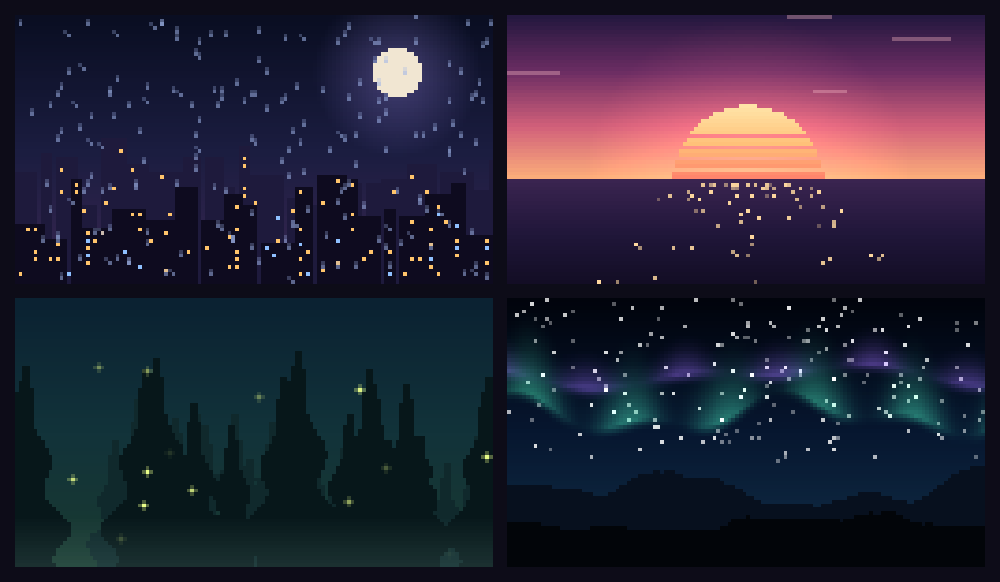

# mellow

A lofi room inside your terminal session: live lofi streams, Spotify playlists and
animated pixel scenes in a side pane, so the music lives where you work.



Under the scene sits the player:

```
 ♪ Lofi Girl [live]
   beats to relax / study

 ⏮  [ ⏸ pause ]  ⏭   vol − ██████░░░░ +  60%
 stations   Rainy city   pictures
```

## Install

At the prompt of a terminal session:

```
/plugin install mellow --marketplace DenisSoldugeev/mellow-term
```

From a shell:

```
claude plugin install mellow --marketplace DenisSoldugeev/mellow-term
```

Audio needs two command-line tools:

```
brew install ffmpeg yt-dlp      # macOS
sudo apt install ffmpeg yt-dlp  # Debian / Ubuntu
```

Answer `y` to add the marketplace, then pick a scope. Spotify stations drive the
Spotify desktop app on macOS (through AppleScript), so you hear full tracks with
your own account and the cover art shows in the pane.

## Use

| Command | What it does |
| --- | --- |
| `/mellow` | open the player pane |
| `/mellow play [name or #]` | play the current or a named station |
| `/mellow pause` · `stop` · `next` · `prev` | transport (next/prev skip tracks on Spotify) |
| `/mellow vol 40` | volume, 0–100 |
| `/mellow scene [rain\|sunset\|forest\|aurora\|off]` | switch the picture |
| `/mellow add <link> [name]` | add a YouTube live, Spotify playlist/album or radio stream URL |
| `/mellow remove <name>` | remove a station you added |
| `/mellow pic ~/Pictures/cozy.jpg` | use your own picture |
| `/mellow list` | list stations |
| `/mellow help` | all of the above |

In the pane (click it or press ctrl+x tab): `k` play/pause, `j`/`l` previous/next
station, `d`/`u` volume, `b` next picture, `s` station list, `p` picture list.
While music plays the status line shows what is on.

Scenes are drawn with half-block characters and work in any terminal. Your own
pictures and Spotify covers use the kitty graphics protocol (Ghostty, kitty,
WezTerm); elsewhere their name shows instead.

## How it works

- YouTube live streams are resolved with `yt-dlp` and played by `ffplay` without
  video. When a channel restarts a stream under a new ID, mellow finds the new one
  on the channel's streams tab and remembers it.
- Spotify playback, volume and skips go to the desktop app; its now-playing info
  is polled every few seconds.
- Your stations, pictures, volume and scene are kept between sessions.

Streams and playlists belong to their creators. mellow only plays what their
public pages already offer.

## License

MIT
